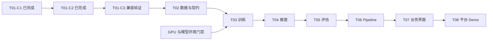

# 铁路勘察设计知识注入平台：总体规划

记录日期：2026-11-09（Asia/Hong_Kong）。本轮授权：接续原对话并规划整个项目。
最新状态核对：2026-11-11。T02-A/B 历史合成场景与公开对话 JSONL 数据流程通过。T03 适配器源码与 CPU 预检通过。T03-A 的 GPU 环境验收仍受阻，真实训练未启动。
本文区分历史验收与后续计划，不自动授权实施后续阶段。
实际状态见 [STATUS.md](STATUS.md)、[HANDOFF.md](HANDOFF.md) 和阶段验收报告。

## 当前交付范围（2026-11-10 用户明确）

本项目只承担“第二部分：平台开发”：网页上传数据、发起模型训练、部署模型、调用模型、查看评估结果。
本轮已核验用户附件《技术方案.md》V0.1（建设目标 Demo V1.0），以其 ClearML 二次开发及成熟组件集成路线为依据。
不自研训练/推理/评估算法或底层调度，不默认集成 ClearML 或外部工具的全部功能；保留原生页面并补齐必要入口。
Unsloth 为优先训练组件，OpenCompass 为方案指定评估组件；具体版本、模型和依赖在接入时验证，不冒称已经接入。
Demo 使用公开数据和开源模型，至少真实跑通一条数据准备→训练→部署→推理→评估流程，并能从网页操作和查看结果。
旧 T09 专业场景科研、专家评价、论文/科研成果及课题验收不属于当前交付范围；保留历史编号，不将其列为平台完成门槛。
平台评估能力、必要测试和基本测试评估报告仍在范围内；真实训练/服务调用不可用静态页面或 Mock 替代。
《工作进度汇报》本轮未提供、未核验，不推断其具体条款；本轮范围澄清不自动授权后续实施。

### 五项功能对应的开发内容

| 用户操作 | 平台开发/适配内容 | 复用组件 | 当前差距 |
|---|---|---|---|
| 上传数据 | 上传校验、必要解析/格式转换、数据版本与选用入口 | Dataset + 成熟文档/数据工具 | T02-A/B 及公开对话 JSONL 网页数据流程已验，18/6 训练输入已固定。其他输入形态未验 |
| 训练模型 | 选择数据/基座、基本参数、作业提交、状态日志和模型产物 | Unsloth 优先 + Task/Agent/Models | 训练适配器与 CPU 预检通过。真实 GPU 微调和模型产物待验 |
| 部署模型 | 选择模型版本、服务启停、健康检查、可调用地址 | 成熟部署组件 + 平台运行记录 | 未交付 |
| 调用模型 | 提交请求、调用服务、展示输出和错误 | 已部署推理 API | 未交付 |
| 查看评估结果 | 发起评估、关联模型/数据版本、展示指标和报告 | OpenCompass + Logger/Artifacts | 未交付 |

重点是组件封装、参数/资产流转、流程编排、必要网页入口与结果展示，不实现算法内部。
可以先用脚本验证适配，最终仍须从网页操作一条真实闭环；仅网页壳或手工脚本不算交付。
不要求专家评分、多专业场景科研验证或证明模型效果提升；平台功能测试和基本测试评估报告仍需要。

## 1. 来源与项目目标

- 已读取《规划Codex实施方案》的最新消息，并恢复
  [分享对话](https://chatgpt.com/share/6af1ce16-88cc-83ec-9367-2e81c8e534bc)
  中的历史方案及用户转贴的 T00 审计；保留 T 编号和 C1/C2/C3 的最新任务拆分。
- 恢复的项目目标：把铁路勘察设计领域文档转化为可管理的知识数据，完成模型微调、
  部署推理和效果评估，形成可追溯、可复现的工作流及业务操作界面。
- 原附件为《技术方案(1).md》《领域知识注入工具平台研发-技术路线.docx》、
  《面向铁路勘察设计领域的知识注入工具平台关键技术研究-最终版.doc》。
  初次规划时未取得这些原文件；2026-11-10 已另核验用户本轮提供的《技术方案.md》V0.1，
  不推断与旧同名附件逐字一致；其余原始需求文件和旧 ZIP 尚未核验，聊天转述不等同于正式条款。
- 原对话建议用 ClearML 路线替代旧 Vben / FastAPI / MLflow / SWIFT 组合。
  当前 ClearML 基础设施已验收；本轮附件明确 Unsloth 优先、OpenCompass 评估的接入方向，
  接入实现及运行能力仍未验证。需求与架构冲突须回到原材料核对。
- 不少于三个专业场景、专家评分、科研成果及 2027 年课题安排来自原对话转述，
  仅保留为 T09 的历史背景；按用户本轮“只需平台开发”的明确范围，不纳入当前交付和验收。

## 2. 当前平台交付与历史范围

| 层次 | 目标 | 完成依据 |
|---|---|---|
| Demo V1.0 | 文档导入 → 数据处理 → 微调 → 部署/推理 → 评估，能从界面发起并回看结果 | T02–T08 的真实任务、模型、推理响应、评估及复现证据；Mock/dry-run 只验接口 |
| 课题验收版（历史范围，当前排除） | 保留旧规划背景，不在本项目平台开发范围内 | T09 不作为平台 Demo 完成门槛，不自动启动 |

尚需落实公开 Demo 样例、必要用户流程、基座模型、计算资源和部署目标。
验收重点是平台操作、真实执行、资产关联和结果可核对，不默认设定模型精度提升门槛。
`rail-cpu` 命名本身不构成具体场景或模型选型依据。

## 3. 当前起点

| 范围 | 当前证据与限制 |
|---|---|
| T00 | 用户确认完成；本地无独立报告，原对话有用户转贴的历史审计；本轮未复验全部检查 |
| T01-A | 官方 `clearml/server:2.4.0` 六服务历史验收通过，Web `2.4.0-722` |
| T01-B | CPU Agent 实际执行 Smoke，completed、参数/日志/指标与 Artifact 校验历史通过；不包含训练 |
| T01-C1 | 本轮规划期间其他实施任务已写入完成记录；主应用/Widgets 构建及资源完整性通过，详见 [构建报告](T01C1_BUILD.md)；本轮只读核对报告和原证据，未重建 |
| T01-C2 | 已完成；独立 18080 release v2、配置/代理/Widgets、隔离浏览器基础认证读取通过；[报告](T01C2_DEPLOYMENT.md) |
| T01-C3-A | 只读检查与问题记录已完成；[报告](T01C_COMPATIBILITY.md)保留原失败；缺样本/受限项未验 |
| 独立 Artifact 下载修复 | [修复报告](T01C_ARTIFACT_DOWNLOAD_FIX.md)通过；36 项边界复验及源/发布清单、真实下载文件核对通过；当前新版 18080 健康 |
| C3-B 首轮 | [夹具报告](T01C3B_FIXTURES.md)限定验收通过；两 Dataset 版本、Model↔Task 与可用下载入口已验，GENERAL inline/文本预览/输入消费限制保留 |
| 完整 T01-C3 | 仍未通过；Model GENERAL/菜单下载行为、Pipeline、四风险触发与其他受控项仍待分别验收或明确范围裁定 |
| 业务组件 | 对话数据准备核心、网页入口及公开 JSONL 样例已验。文档解析、训练、推理、评估和业务 Pipeline 待接入或验证 |
| GPU | T03-A 复验 `nvidia-smi` 退出 9，VMware 来宾无 NVIDIA PCI 设备；真实训练条件受阻 |
| Git | 本地版本检查点已完成；根与 Web 的成果已提交、未 push，两个 Fork 保持独立；恢复范围见 [检查点报告](VERSION_CHECKPOINT.md)；最新工作区修改仍须逐次检查 |
| 运维 | 完整文件访问控制、远程端到端、环境重建、重启/备份恢复及长期负载未验收 |

规划期间重新读取了 C1 更新后的 AGENTS / STATUS / HANDOFF / DECISIONS，保留其成果。
官方 8080 六服务基线保留；18080 已独立提供 Web 2.5.0 Fork，后端仍为官方 Server 2.4.0。
两站版本分别记录；C2 浏览器拦截了偏好/统计写入及外部请求，Server Fork 仍未运行验证。
18080 当前为独立下载修复 release `artifact-download-20261110-v1`，版本
`2.5.0-artifact-fix-0b92177bcb35`；Web HEAD 仅为基点，另有未提交补丁/源码清单，旧 C2 v2 保留。
基础与 CPU 链路依据：[部署结果](../infra/DEPLOYMENT_RESULT.md)、[T01-B 验收](T01B_ACCEPTANCE.md)。

## 4. 架构与代码归属

复用 ClearML Web / Server / SDK 的项目、任务、队列、日志、指标、数据集和模型能力；
由独立 Python 组件承担知识处理、训练、部署推理和评估，再以 Pipeline 串联。
业务页面沿用现有 Angular Fork，不同时另建一套任务数据库、调度器或 MLOps 后台。
优先通过 SDK / 现有 API 适配；确有运行证据证明需要时再评审 Server 扩展。

以下为后续代码归属建议，本轮不创建空实现或迁移目录：

| 区域 | 职责 |
|---|---|
| `schemas/` | 组件、数据、评估结果的输入输出契约 |
| `integrations/extraction/` | 文档解析、清洗、样本生成与数据资产登记 |
| `integrations/training/` | 训练适配、模型与 adapter 登记 |
| `integrations/deployment/`、`integrations/inference/` | 服务生命周期与推理调用 |
| `integrations/evaluation/` | 评测框架适配、评分和错例报告 |
| `pipelines/` | 工作流、步骤依赖与资产传递 |
| `clearml-web/` | 业务表单、流程入口和结果展示 |
| `tests/`、`examples/`、`docs/` | 验收、公开/合成示例及交付文档 |

## 5. 阶段、依赖与验收

T01-C1、本地版本检查点与 C2 已完成；C3-A 仅采证完成，完整 C3 未通过；后续任务仍须授权。

| 阶段 | 目标与交付 | 前置条件 | 完成门槛 |
|---|---|---|---|
| T01-C1（已完成） | 主应用/Widgets 构建；[报告](T01C1_BUILD.md) | 已按原任务授权完成 | 两个正式构建、资源完整性及基线前后检查通过；不外推部署兼容 |
| 版本检查点（已完成） | 三个独立仓库的本地提交及源码恢复；[报告](VERSION_CHECKPOINT.md) | 已按独立任务授权完成 | 三个 bundle verify、独立恢复、tree/哈希/fsck 通过；只证明本地源码可恢复，未 push，不等于数据库或环境恢复 |
| T01-C2（已完成） | Fork 独立站点；[部署报告](T01C2_DEPLOYMENT.md) | 已按独立任务授权完成 | 18080、release/路径/代理/Widgets 及受限浏览器基础读取通过，原服务和 Agent 不变；不代表完整 C3 |
| T01-C3（完整验收未通过） | [兼容报告](T01C_COMPATIBILITY.md)、[Artifact 修复](T01C_ARTIFACT_DOWNLOAD_FIX.md)、[首轮夹具](T01C3B_FIXTURES.md)已形成 | 每轮修复/夹具/操作分别授权 | 首轮 Dataset/Model 版本关系与可用下载通过；GENERAL 下载及后续风险路径仍待验，不外推完整兼容 |
| T02 | 数据上传/处理、训练/验证 JSONL、Dataset 版本与选用入口，补齐组件契约 | 必要数据/任务接口与 CPU Agent 基线已验，按业务依赖裁定 C3 阻塞后单独授权；公开样例明确 | 必要正常/异常样例、来源/划分可追溯，组件由 Agent 执行并回读；逐步接入网页上传/处理入口 |
| T02-A / T02-B（限定通过） | A 为 CPU 核心与契约，B 为网页上传、真实 Agent 处理、下载与数据选择 | 两轮合成验收通过，历史资产保留 | 见 [T02-A 报告](T02A_DATA_PREPARATION.md) 和 [T02-B 报告](T02B_WEB_DATA_ENTRY.md)。公开 JSONL 交接已通过，见 [公开数据报告](T02_PUBLIC_DATA_ACCEPTANCE.md) |
| T03 | 真实训练适配器；Unsloth/LoRA 初选，经验证后固定 | T02 数据、评测划分、GPU 门禁、模型和依赖版本明确 | Agent 真实训练；记录数据/基座 revision/参数/代码/环境；产物可加载，指标与哈希可核对；dry-run 不计训练通过 |
| T03-A（GPU 环境受阻） | 数据、资源诊断、固定 revision 与 CPU 模板检查通过，见 [训练准备验收](T03A_TRAINING_READINESS.md) | 已固定 OASST1 输出 Dataset 版本与哈希；来宾需获得 GPU 设备和匹配驱动 | 独立环境安装、PyTorch GPU 运算与 Unsloth 导入待实测 |
| T03 训练适配器（CPU 验收通过） | 参数化入口、数据/模板/labels/错误路径通过 CPU 验收，见 [适配器验收](T03_TRAINING_ADAPTER.md) | 固定 Dataset 和模型 revision，GPU 资源仍待落实 | Unsloth 路径、实际优化更新和 Model 产物待 GPU 实测 |
| T04 | 微调模型部署和推理接口 | T03 有效产物，推理资源与模型组合明确 | 加载正确基座+adapter；健康检查及真实请求通过；记录模型身份、超时/异常行为、endpoint 启停 |
| T05 | OpenCompass 等评估适配，汇总及逐样本结果 | 口径在 T02/T03 前确定；有真实 endpoint 或确认的本地推理路径 | 基座/微调模型在同一固定验证集可比；分数可复核，失败样本/错例可追溯；演示分数不能代替效果结论 |
| T06 | 完整业务 Pipeline | T02–T05 分别通过，契约固定 | 真实串联处理→训练→部署/推理→评估；资产 ID/版本、DAG、步骤状态、失败/重试/停止可追踪；controller/step 队列并发策略通过验证 |
| T07 | Angular 业务操作入口 | T01-C 与 T06 通过，用户流程明确 | 配置/发起流程、查看进度/错误/评估、跳转原生 Task/Dataset/Model，浏览器端到端验收通过 |
| T08 | Demo V1.0 联调、复现与运行交付 | T02–T07 通过，部署目标和运行指标明确 | 获准样例真实端到端执行；约定干净环境可重建；版本/资产可追溯，下文试用门禁通过，有演示与验收报告 |
| T09（历史范围，当前排除） | 专业场景科研验证与课题交付 | 不属于当前平台开发授权 | 不作为 T08 平台交付门槛；若以后另有任务，须用户重新明确范围 |

C3 收口应围绕五项平台流程实际依赖的功能、接口和必要访问控制；无关原生功能保留原实现，
不默认扩成全量 ClearML 验收。具体保留限制须在后续任务裁定，当前完整 C3 仍未通过。
T01-C 是 Fork 集成验证，T02-B 先接数据入口，T07 汇总完整业务界面。原早期“两步骤小 Pipeline”建议
可另立基础验证任务；它不属于 C1–C3，也不能替代 T06。

## 6. 并行准备与训练门禁

- 需求、数据契约、验证集和评估口径设计先于训练；CPU 数据处理不以 GPU 修复为前置。
  并行实施须明确授权，不在 C2 部署任务里顺带开发 T02。
- GPU 条件独立安排：确认主机/虚拟机可用硬件与显存、驱动及框架要求，再验证采用的
  虚拟环境或容器、真实计算和队列任务。是否使用容器另定，不自动重配 Docker。
- 训练前固定基座 revision、tokenizer、训练框架、量化/adapter 配置，测量显存与磁盘预算。
  没有可用训练资源时可验接口，真实训练及 Demo 闭环保持未通过。
- T01-B 单脚本快照和复用宿主机环境只证明 Smoke 链路；后续须验证任务源码引用、
  依赖锁定和约定环境重建。虚拟环境/容器方案在对应实施任务中选择并记录。

## 7. 共享契约与评估原则

以下是拟定契约内容，不是已恢复的原任务包字段或已落地 schema：

| 组件 | 应传入/记录 | 应产出/核验 |
|---|---|---|
| 知识处理 | 文档标识/哈希、解析清洗配置、使用范围 | 数据版本、训练/验证划分、来源映射、质量/异常报告 |
| 训练 | 数据资产、基座 revision、参数/种子、代码/环境 | Task ID、指标、模型/adapter/哈希、加载要求 |
| 部署/推理 | 基座+adapter 身份、推理配置、资源/超时 | endpoint 或推理产物、健康状态、输出与生命周期 |
| 评估 | 固定验证集、模型身份、提示/生成配置、指标版本 | 汇总指标、逐样本输出/评分、失败样本/错误分析 |
| Pipeline | 不可变资产引用与步骤参数 | controller/step Task ID、状态、资产关系和失败原因 |

F1、BERTScore 等只是原对话举例，不要求自研指标或专家量表；实际指标按接入工具和 Demo 配置确定。
记录数据划分、模型/数据版本、提示/生成配置、指标名称和结果来源，验证评估执行与展示可追溯。
不以证明效果提升或完成科研对比作为平台门槛；真实评估运行、功能测试与基本报告仍须通过。
合成样例用于功能测试，公开数据/开源模型用于真实 Demo；原始数据和权重不默认进入 Git。

## 8. 当前主线与保留候选（均未授权实施）

按五项用户流程区分必要阻塞、可保留限制和无关原生能力，不以全量 ClearML 验收为目标。
现有 Model 可用下载入口已验，GENERAL/菜单 inline 行为继续留作问题；原最小修复提示词
转为按业务必要性安排的候选，不再默认优先于上传/处理和组件接入，也不宣称问题已修复。
Pipeline/队列只验证本平台实际采用的依赖；休眠接口、报表分享等无关功能不无限扩成硬门槛。
完整 C3“未通过”不因范围调整改成通过；后续须明确保留限制及必要项验收结论。
T02-A/B 与公开对话 JSONL 数据流程已通过。T03-A 在 GPU 环境验证处受阻。真实训练及后续阶段依用户另行授权启动。
GPU 资源由宿主机分配或独立节点接入。资源落实前已完成 [训练适配器与 CPU 预检](T03_TRAINING_ADAPTER.md)，包含只读 Dataset 获取、固定 tokenizer、多轮标签、动态 padding 和 CUDA 缺失门禁。

本轮已实施范围见 [T02-A 提示词](T02A_TASK.md)：固定对话JSONL输入契约，完成CPU数据准备
组件、真实 Agent 执行及 Dataset 回读；网页上传/数据选择入口留作 T02-B。
T02-A 已按独立授权限定通过，见 [实施报告](T02A_DATA_PREPARATION.md)；其通过不等于整个T02或完整C3通过。
合成样例用于功能测试。公开对话数据上传至交接已验，完整 Demo 的训练及后续阶段须用户明确授权。

T02-B 已按 [任务要求](T02B_TASK.md) 完成网页闭环与 Fork 回退恢复，见 [验收报告](T02B_WEB_DATA_ENTRY.md)。
公开 OASST1 小样本已走通网页流程，输出 Dataset `65d2ce482a484ff0a7e2ef6f0f4dbe67` v1.0.0、训练 18 / 验证 6，Manifest 和文件哈希见 [公开数据验收](T02_PUBLIC_DATA_ACCEPTANCE.md)。
现有入口支持逐请求台账与 1 MiB 内 JSONL，公开样例使用当前项目中的新请求。实施范围见 [公开数据验证提示词](T02_PUBLIC_DATA_TASK.md)。

### 保留候选：Model GENERAL/菜单下载最小修复

本地版本检查点及 C2 已通过；源码/产物/镜像/运行版本以各自报告为准。
C2 部署文件尚未提交，保留其全部成果；GitHub 不能替代当前本地工作区作为最新状态来源。

C3-B 首轮已在独立项目创建两个 Dataset 版本、Draft Task 与一个 OutputModel，
两站各 24 步、3 份真实下载通过，原失败/限制留在兼容矩阵，不重复造夹具。
GENERAL 有明确下载图标和 downloadModelClicked 处理器，但当前只导航至签名 URL；
模型菜单亦有相同处理方式。两站 inline JSON 是共有行为限制，不能直接归因 Server 不兼容。
已有 Task 输出 Model 下载入口通过，不因此把 GENERAL 入口记为通过，也不推翻首轮限定结论。

下一轮拟允许 Web Model 下载链路最小修改、必要测试、独立正式构建与新固定 release，
仅更新 Fork 18080；本轮只交付提示词，不实施。不得改 Server/CORS/鉴权、既有对象或原六服务/Agent。

1. 复用首轮 Model `62ec3a648ff74162bd1a5c13b844b79d`、Draft Task
   `388557dbadf6452fba94d9ab5e8f3ce6` 和台账；不新建/修改/删除业务对象。
2. 确认 GENERAL 与实际模型菜单下载入口，统一复用已验证的可信 URL/下载 helper，
   保留外部/S3 签名语义；不能宽松扩大 Fileserver 信任，不手改历史 Model URI。
3. 用实际触发路径测试和必要 URL/HTTP 边界验证改动；不只重复已有 helper 的单测。
4. 主应用/Widgets 输出独立目录，保留 C1/C2/Artifact 修复产物、版本与清单；
   新未提交源码用 HEAD+补丁/清单哈希标识，不冒称旧 HEAD 已包含修复。
5. 新固定 release 仅切换 Fork；回退到当前 Artifact 修复 release，再恢复新版。
   原六容器/Agent 不变，只有 Fork 身份可因部署变化。
6. 从原页面点击 GENERAL 与可用模型菜单下载按钮，捕获真实 download，
   保存已有 118 字节 Model 文件，逐字节/SHA256 对照台账；不改 DOM/href 或伪造响应。
7. 回归已通过的 Task 输出 Model、历史 Artifact、Dataset 两版本/下载、基础登录/Widgets/代理，
   保留只读保护及全部已知限制，不把外部真实签名或输入消费关系算为已验。
8. 新增 `docs/T01C_MODEL_DOWNLOAD_FIX.md`，在兼容报告追加前后结果并同步 STATUS/HANDOFF；
   单项修复通过仍不等于完整 C3 通过，后续再单独安排 Pipeline 草稿/专用队列及风险路径。

C3 保留历史 T00 的四个风险端点：`pipelines.check_new_run`、`queues.get_by_task_id`、
`tasks.get_operations_log`、`reports.share`。C3-A 已作静态分类，但四项都未实际触发，
响应为 N/A，不能认定全部阻塞或通过；`reports.share` 不作为只读请求试调用。
后续 C3-B 须明确专用测试对象、允许创建/更新/清理的范围；Dataset 可能创建承载 Task，
必须单独说明。默认仍禁止入队、Agent 执行、真实训练及 Pipeline controller，不能暗中扩大范围。
Server Fork 如只完成静态评估，仍保持“未通过运行验证”；实验实例和数据需隔离。

## 9. Demo 试用门禁

在 T08 接受试用前，为以下事项分配独立任务或明确纳入已授权范围：

- 登录及目标客户端远程访问端到端通过，继续保持回环应用端口、数据库不发布的基线。
- 账号及文件访问控制有实际正/负例，不能从一次认证 API/Artifact 下载外推完整策略。
- 在约定维护范围验证服务/Agent 重启恢复；真实主机重启另行安排。
- 明确一致性备份及恢复目标，在隔离目标恢复并核验 Task/资产，保留现有卷与数据。
- 按预先确认的并发、数据量、模型资源、磁盘增长及失败场景验收。
- 记录镜像 digest、Fork 提交/补丁、构建产物、代码/依赖/数据/模型版本及回退步骤。

## 10. 协作与排期

以后以仓库文档交接：每个阶段先定义范围，实施后凭实际测试验收，再更新 STATUS/HANDOFF。
同一工作区可直接读取证据，无需用户反复转贴完整输出；并行任务应明确文件归属，写文档前
重新核对最新版本，避免覆盖其他任务。不同工作区未同步的改动不能算已交付。
GitHub 需在版本检查点、敏感信息检查和获准推送完成后，才能作为可靠的远程交接来源。

原“八周 Demo”依赖 Fork 可用、人力和可用 GPU，当前不据此承诺交付日期。
在 C2/C3、首场景/数据/模型和 GPU 资源明确后，再估算 T02–T08 工时与排期。
2027 课题节点仅为历史背景，按本轮用户范围不纳入当前平台排期。

T02 公开对话数据验证与训练输入交接已通过。后续顺序为 T03 训练环境和适配 → 部署、调用、评估及必要网页功能，各阶段须独立授权。
[T03-A 训练准备验收](T03A_TRAINING_READINESS.md) 已记录固定模型、模板验证和候选训练配置。待虚拟化管理员确认 GPU 分配或提供 GPU 节点，再按授权续验独立训练环境。
已有替代路径的原生功能问题保留为候选改进，不默认阻塞全部平台开发；未验证状态如实保留。
正式需求与评估口径在 T02/T03 前补齐，未验证项不因任务拆分自动变为通过。
本轮只完成规划和文档检查，不运行构建、部署、训练或 Pipeline。

### 11 月近期优先级

规划期间，其他任务在 [STATUS.md](STATUS.md) 新增了《开发计划11月(1).md》的逐项核对。
本轮保留该记录，未直接读取其原附件；以下依据该任务的对照结果，实施仍须明确授权：

- 必做缺口优先：基础平台浏览器/数据集功能、目标云端部署及远程端到端、名称/Logo/菜单基础适配。
  CPU Agent 基础链路已验收；不能把 C1 构建或本机部署外推为全部月度任务完成。
- 基础品牌和必要菜单可在 C3 后单列小任务，不必等待 T07 完整业务工作流界面。
  平台名称、Logo 和必需入口应先明确，避免将品牌修改扩成未授权重构。
- Unsloth 初步接入是争取项；GPU 就绪与真实训练仍受 T03 门禁约束，不据此阻塞全部月度交付。
- 当前为 11 月 9 日，既不宣布月底计划完成，也不据当前缺口认定已经延期。

## 11. 官方能力参考

查阅日期：2026-11-09。仅核对可行性，latest 文档不证明本机锁定版本已验收。

- [Agent 执行环境](https://clear.ml/docs/latest/docs/clearml_agent/clearml_agent_execution_env/)：
  虚拟环境和 Docker 两类模式；后续验证所选模式的实际重建。
- [ClearML Pipelines](https://clear.ml/docs/latest/docs/pipelines/)：
  controller 组织依赖，远程步骤通过队列执行；本项目 T06 仍未实施。
- [Server 访问控制](https://clear.ml/docs/latest/docs/deploying_clearml/clearml_server_security/)：
  分别考虑 Web 登录、服务凭据与文件保护；沿用现有已确认边界。
- [部署及备份恢复](https://clear.ml/docs/latest/docs/deploying_clearml/clearml_server_linux_mac/)：
  核对一致性要求；本项目使用命名卷，须另写适用方案并在隔离目标验证。
